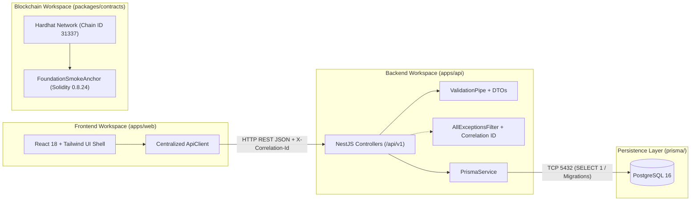

# PDSChain v2 — System Architecture

## 1. Architectural Overview

PDSChain v2 is structured as a modular TypeScript monorepo separating presentation (`apps/web`), backend application services (`apps/api`), relational persistence (`prisma/` + PostgreSQL 16), and on-chain smart contracts (`packages/contracts`).

---

## 2. Workspace Breakdown

### 2.1 Frontend (`apps/web`)

- **Framework**: React 18 with Vite 6 and TypeScript in strict mode.
- **Routing**: React Router v6 (`/` Welcome screen, `/status` Service Status & Readiness console, `*` NotFound page) wrapped in a top-level `ErrorBoundary` and responsive `AppShell`.
- **Component System**: Reusable accessible primitives in `src/components/ui/` (`Button`, `Card`, `Input`, `StatusBadge`, `LoadingIndicator`, `ErrorDisplay`, `ErrorBoundary`).
- **Centralized API Client**: `src/lib/api-client.ts` normalizes `VITE_API_BASE_URL`, parses standardized backend error envelopes, preserves `x-correlation-id` headers, and distinguishes network failures (`NETWORK_UNAVAILABLE`) from HTTP application errors.

### 2.2 Backend API (`apps/api`)

- **Framework**: NestJS 11 under global prefix `/api/v1`.
- **Startup Validation**: `src/config/env.validation.ts` validates environment variables via Zod on startup. Missing `DATABASE_URL`, non-PostgreSQL connection strings, or wildcard CORS origins in production fail fast before accepting traffic.
- **Health & Readiness Endpoints**:
  - `GET /api/v1/health/live`: Confirms the Node.js/NestJS process is alive without querying external dependencies.
  - `GET /api/v1/health/ready`: Executes a live `SELECT 1 AS ok` query against PostgreSQL via `PrismaService`. Returns HTTP `200` when PostgreSQL responds and HTTP `503 Service Unavailable` (`DEPENDENCY_UNAVAILABLE`) when PostgreSQL is unreachable.
  - `GET /api/v1/health`: Returns a concise health summary (`healthy` or `degraded`) with component statuses and query latency suitable for operator dashboards without exposing credentials or connection strings.
  - `POST /api/v1/health/ping`: Validates `DiagnosticPingDto` using `class-validator` (`whitelist: true`, `forbidNonWhitelisted: true`) to verify payload validation and error handling.
- **Observability & Error Handling**:
  - `CorrelationIdMiddleware` assigns or propagates `x-correlation-id` on every request and logs structured JSON telemetry.
  - `AllExceptionsFilter` formats all HTTP and unhandled exceptions into a uniform `{ status: 'error', error: { code, statusCode, message, details, path, timestamp, correlationId } }` payload.

### 2.3 Database (`prisma/` & PostgreSQL 16)

- **Engine**: PostgreSQL 16 (configured via `compose.yaml` for Docker Compose or `scripts/db-server.mjs` using native PostgreSQL 16 binaries on hosts without Docker).
- **ORM & Migrations**: Prisma ORM (`prisma/schema.prisma`) with version-controlled SQL migrations in `prisma/migrations/`. No SQLite or in-memory database fallback is used.

### 2.4 Smart Contracts (`packages/contracts`)

- **Toolchain**: Hardhat 2.22, Solidity `0.8.24`, OpenZeppelin Contracts 5.2, Ethers.js v6, and TypeChain.
- **Phase 1 Artifact**: `FoundationSmokeAnchor.sol` is a minimal, Ownable smoke-test contract proving compilation, OpenZeppelin import resolution, deployment, event emission, and receipt verification on the local Hardhat network (`chainId: 31337`).
- **Deployment Manifest**: `scripts/deploy-local.ts` writes local deployment metadata (chain ID, contract address, deployer address, deployment and smoke-check tx hashes) to `packages/contracts/deployments/local.json` (gitignored).
