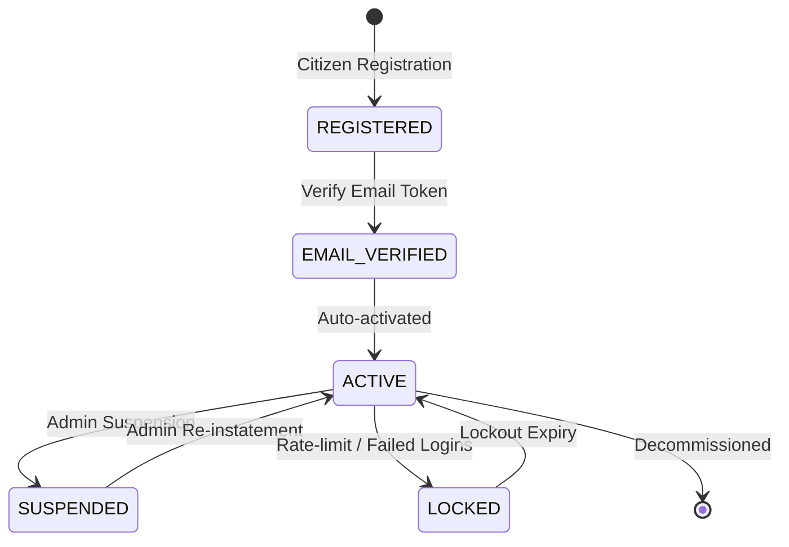

# PDSChain v2 — Phase 2 Authentication Architecture

## 1. Executive Overview

Phase 2 establishes the identity, authentication, and session foundation for PDSChain v2. Every operational action across the Public Distribution System (grain deposits, warehouse dispatches, fair price shop sales, ration entitlements) depends upon verifiable, auditable identity.

This document describes the authentication subsystem design, cryptographic primitives, session storage lifecycle, email verification mechanics, and password reset procedures.

---

## 2. Authentication Primitives & Cryptography

### 2.1 Password Hashing: Argon2id

- **Algorithm**: `Argon2id` (RFC 9106 recommended profile for authentication against side-channel and GPU cracking).
- **Library**: `@node-rs/argon2` (high-performance SIMD/native implementation).
- **Parameters**:
  - Memory Cost (`m`): 65,536 KiB (64 MiB)
  - Time Cost (`t`): 3 iterations
  - Parallelism (`p`): 4 threads
  - Output Key Length: 32 bytes (256 bits)
  - Salt: Cryptographically secure random 16 bytes per password hash.

### 2.2 Security Tokens

- **Generation**: Tokens for email verification, password reset, and session IDs are generated using `node:crypto.randomBytes(32)` providing 256 bits of CSPRNG entropy, formatted as 64-character hexadecimal strings.
- **Storage Protection**: Tokens sent to users are never stored in plaintext in PostgreSQL. The backend computes the SHA-256 digest:
  $$\text{tokenHash} = \text{SHA-256}(\text{rawToken})$$
  and stores only `tokenHash`. If the database is compromised, active verification or reset tokens cannot be extracted or redeemed without solving SHA-256 pre-images.
- **Single-Use Enforcement**: Tokens include a `usedAt` timestamp. Once redeemed, the record is immediately marked `usedAt = now()`. Replay attempts fail with `TOKEN_ALREADY_USED` or `INVALID_OR_EXPIRED_TOKEN`.
- **TTL (Time-To-Live)**:
  - Email Verification Token: 24 hours.
  - Password Reset Token: 1 hour.
  - Session Inactivity: 12 hours rolling / 7 days maximum duration.

---

## 3. Session Management & HTTP Transport

### 3.1 Stateful Database Sessions

Sessions are tracked in the `sessions` PostgreSQL table with:

- `id`: Session UUID.
- `sessionTokenHash`: SHA-256 hash of the random cookie value.
- `userId`: Foreign key to `users.id`.
- `ipAddress`: Remote IP recorded for geo-velocity / fraud detection.
- `userAgent`: Client agent string.
- `createdAt`, `lastActiveAt`, `expiresAt`.
- `revokedAt`, `revocationReason`: Set upon explicit logout, password change, or admin suspension.

### 3.2 Secure Cookie Delivery

Cookies are transmitted via Express `res.cookie` with:

- `HttpOnly`: True (inaccessible to JavaScript, defending against cross-site scripting session exfiltration).
- `Secure`: True when `COOKIE_SECURE=true` (enforced in production HTTPS).
- `SameSite`: `'Lax'` for cross-navigation protection with standard browser links.
- `Path`: `'/'`.

### 3.3 CSRF Protection (`Double Submit Cookie Pattern`)

- A secondary cookie `pdschain_csrf` is set on login and verified on state-changing REST calls (`POST`, `PUT`, `PATCH`, `DELETE`).
- The frontend client reads `pdschain_csrf` or the login response payload and passes it in the `X-CSRF-Token` HTTP header.
- The NestJS `SessionAuthGuard` validates that the header token matches the session CSRF context.

---

## 4. Account Lifecycle State Machine

1. **Citizen Registration**:
   - Accepts `fullName`, `email`, `password`, `confirmPassword`, `acceptTerms`.
   - Rejects duplicate emails (`EMAIL_ALREADY_REGISTERED`).
   - Automatically provisions `CITIZEN` role.
   - Generates verification token and queues email via `MailService`.
2. **Email Verification**:
   - Can be redeemed via GET link or explicit POST submission.
   - Sets `users.emailVerified = true` and `users.emailVerifiedAt = now()`.
   - Updates account status to `ACTIVE`.
3. **Password Reset**:
   - Reversible forgot-password endpoint returning generic success message to prevent user enumeration.
   - On valid token submission, updates `users.passwordHash` with new Argon2id hash.
   - **Revokes all existing active sessions** for that user immediately in PostgreSQL to thwart hijacked sessions.

---

## 5. Development Mailbox Catcher (`.dev-mailbox/`)

In local development and automated testing environments:

- External SMTP relays are avoided to maintain full offline repeatability.
- Outgoing transactional emails (verification tokens, password resets) are formatted as JSON payloads and persisted to `.dev-mailbox/<email>.json`.
- Automated Playwright browser tests and manual testers inspect `.dev-mailbox/` to extract valid tokens instantly without network dependency.
