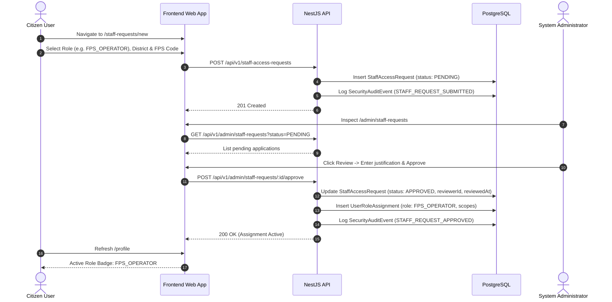

# PDSChain v2 — Phase 2 Role-Based Access Control (RBAC) & Governance

## 1. Canonical Roles

In accordance with Phase 2 requirements, PDSChain v2 enforces exactly five canonical roles. Legacy and conflicting names (`STATE_ADMIN`, `FPS_DEALER`, `AUDITOR`) have been unified into this consistent hierarchy:

| Canonical Role          | System Scope               |  Self-Assignable?  |      Approval Prerequisite      | Primary Domain                                                             |
| :---------------------- | :------------------------- | :----------------: | :-----------------------------: | :------------------------------------------------------------------------- |
| **`CITIZEN`**           | Beneficiary level          | Yes (Registration) |    None (Self-registration)     | Ration eligibility, allotment status, staff request submission             |
| **`FPS_OPERATOR`**      | Fair Price Shop scope      |         No         |     Explicit Admin Approval     | Rations dispensing, beneficiary biometric verification, FPS stock receipt  |
| **`WAREHOUSE_MANAGER`** | Warehouse / Depot scope    |         No         |     Explicit Admin Approval     | Grain intake, bulk storage inspection, dispatch consignment creation       |
| **`DISTRICT_OFFICER`**  | District operational scope |         No         |     Explicit Admin Approval     | District allocation oversight, FPS dealership licensing, grievance review  |
| **`ADMIN`**             | System-wide root scope     |         No         | Bootstrap script or Admin grant | Role approval, user suspension, audit event inspection, contract ownership |

---

## 2. Scoped Role Assignments Architecture

Roles are not stored as simple enum strings on the `User` table; they are modeled in `user_role_assignments`:

```prisma
model UserRoleAssignment {
  id            String    @id @default(uuid())
  userId        String    @map("user_id")
  role          AppRole
  districtCode  String?   @map("district_code")
  warehouseCode String?   @map("warehouse_code")
  shopCode      String?   @map("shop_code")
  grantedAt     DateTime  @default(now()) @map("granted_at")
  grantedById   String?   @map("granted_by_id")
  revokedAt     DateTime? @map("revoked_at")
  revokedById   String?   @map("revoked_by_id")
  revokedReason String?   @map("revoked_reason")

  user User @relation(fields: [userId], references: [id], onDelete: Cascade)
  @@map("user_role_assignments")
}
```

### Architectural Guarantees:

1. **Multi-Tenancy & Scope Segregation**:
   - A `WAREHOUSE_MANAGER` assigned to `WH-PATNA-01` cannot read, approve, or dispatch shipments for `WH-GAYA-02`.
   - A `FPS_OPERATOR` assigned to `FPS-104` cannot log transactions for `FPS-105`.
   - A `DISTRICT_OFFICER` assigned to `DIST-PATNA` cannot alter quotas in `DIST-MUZAFFARPUR`.
2. **Immutable Audit History**:
   - Revoking a role does not delete the database row; it sets `revokedAt`, `revokedById`, and `revokedReason`.
   - This ensures full traceability for historical blockchain settlements.

---

## 3. Staff Access Request Lifecycle

Operational users (Fair Price Shop dealers, warehouse superintendents, district officers) register as ordinary citizens and apply for operational privileges through an administrative approval workflow:



---

## 4. NestJS Authorization Guards & Decorators

Authorization is enforced at both controller and handler levels using metadata decorators and NestJS guards:

- `@Public()`: Skips authentication for registration, login, verification, password reset, and health endpoints.
- `@Roles('ADMIN', 'DISTRICT_OFFICER')`: Specifies required canonical roles via `RolesGuard`.
- `@UseGuards(SessionAuthGuard, RolesGuard)`: Applied globally in `AppModule`.
- `@CurrentUser()`: Custom parameter decorator injecting the validated `AuthenticatedPrincipal`.

If an authenticated user lacks the required role, the guard terminates the request with HTTP 403 Forbidden:

```json
{
  "status": "error",
  "error": {
    "code": "FORBIDDEN_RESOURCE",
    "statusCode": 403,
    "message": "Access denied: Required role(s) [ADMIN] not held by current user."
  }
}
```

On the frontend, this triggers client-side redirect to `/unauthorized` informing the user of the access restriction.
